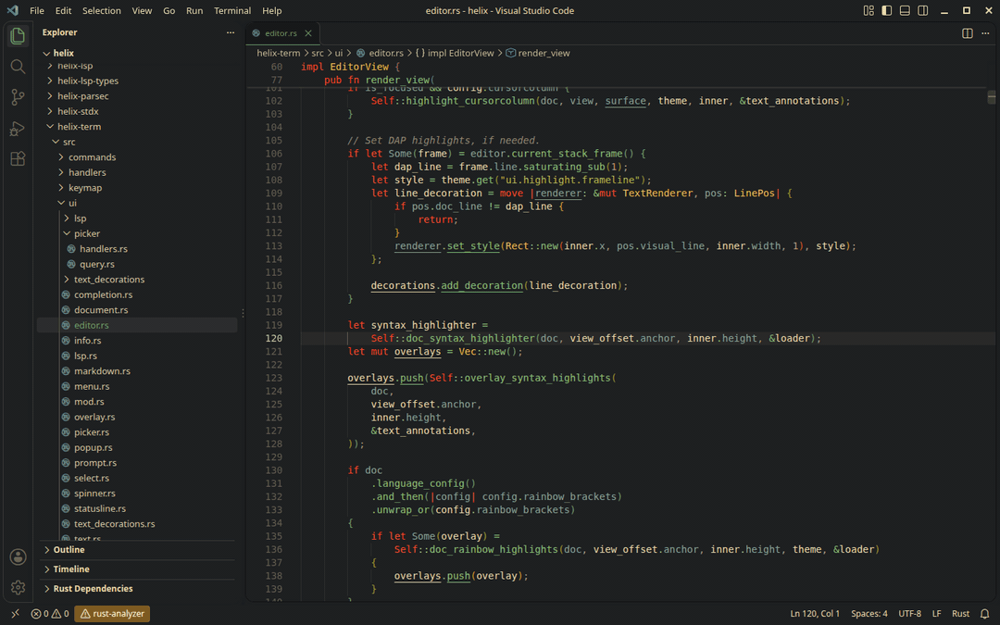
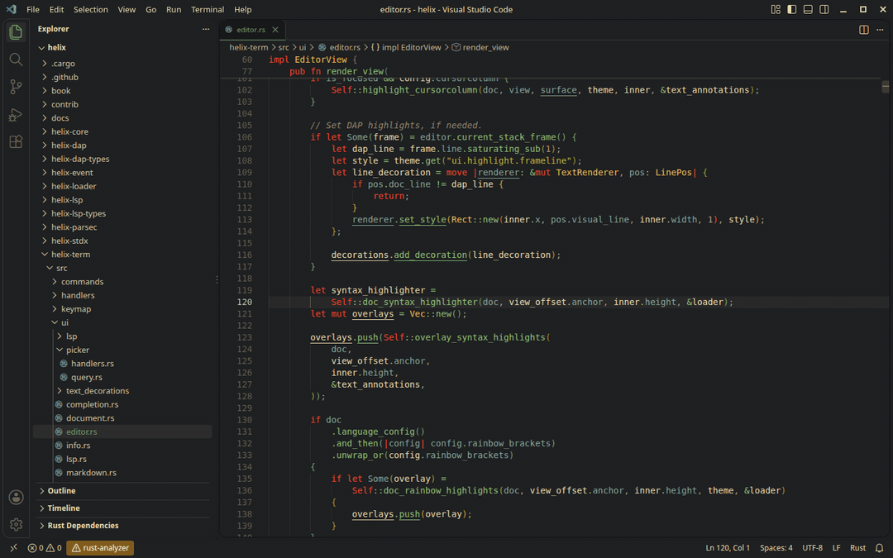
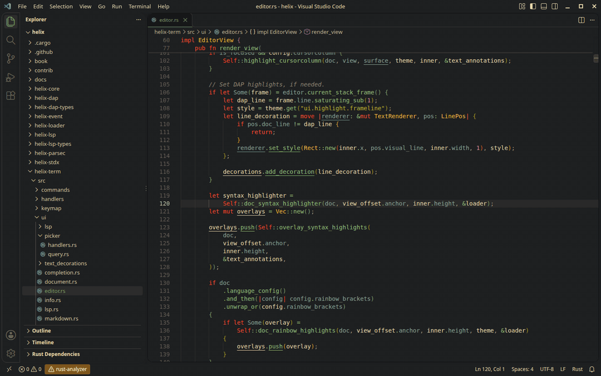

# Gyre

A Helix-style picker for VS Code: files, text and symbols in one overlay, ranked, with a highlighted preview.



## Install

```
curl -LO https://github.com/janthies/gyre/releases/latest/download/gyre.vsix
code --install-extension gyre.vsix
```

Then run "Developer: Reload Window" and press Ctrl-Alt-a for files, Ctrl-Alt-e for text or Ctrl-Alt-s for symbols. The release runs on Linux x86-64 with glibc 2.35 or newer.

---

Everything below is for people who want to know more.

## Why

VS Code finds files by name with Quick Open and text with the search panel. These are two separate tools, and the search panel lists the matching lines in whatever order it happened to walk the files. Helix and Neovim's Telescope have one picker instead, which finds files, text and symbols, ranks what it finds and shows the code around the selected result. Gyre brings that picker to VS Code. Its core is a small Rust program built on the same libraries as Helix's pickers.

The preview is highlighted with tree-sitter, and rather than shipping its own grammars, Gyre borrows the grammars, queries and color themes of an installed Helix. It looks for them in `$HELIX_RUNTIME`, in `~/.config/helix/runtime` and in the usual install locations, including the snap. Without Helix the picker still works, but the preview shows plain text.

## Using it



Gyre adds four commands, each with a default key:

| Command | Key | Opens |
|---|---|---|
| Gyre: Files | Ctrl-Alt-a | a fuzzy file picker over the workspace folders |
| Gyre: Global search | Ctrl-Alt-e | a keyword search across the workspace, ranked by relevance |
| Gyre: Symbols | Ctrl-Alt-s | the symbols of the language servers: the active file's while the query is empty, the workspace's matching the query |
| Gyre: Resume last picker | Ctrl-Alt-q | the last picker again, with its query and selection |

These keys are ordinary VS Code keybindings. To change one, open "Preferences: Open Keyboard Shortcuts", search for `Gyre` and record a new key, as for any other command.

Once the picker is open, the three modes appear at its top, and Alt-Left and Alt-Right switch between them while the query stays. Without a workspace folder, the file and text modes search the folder of the active file. As in Helix, `.gitignore` and `.ignore` files are honored and symbolic links are followed. Unlike Helix, files whose names start with a dot are found as well, except inside `.git` and other version control folders; the setting `helixPicker.hiddenFiles` turns them off. The keys inside the picker follow Helix as well:

| Key | Action |
|---|---|
| Up, Down, Ctrl-p, Ctrl-n, Ctrl-k, Ctrl-j, Shift-Tab, Tab | previous / next result |
| PageUp, PageDown, Ctrl-u, Ctrl-d | page up / down |
| Home, End | first / last result |
| Enter | open in the editor group the picker was opened from |
| Ctrl-v, Ctrl-s | open in a new vertical / horizontal split |
| Ctrl-t | toggle the preview |
| Ctrl-w | delete the word before the cursor |
| Alt-Left, Alt-Right | previous / next mode (files, text, symbols) |
| Alt-1, Alt-2, Alt-3 | switch to files, text, symbols |
| Esc, Ctrl-c | close |

The overlay is VS Code's modal editor, the same one Settings opens in. By default it covers 80% of the window, up to 1400×900 pixels. Its edges can be dragged, and its maximize button enlarges it; VS Code remembers the size for all modal editors.

## How the search ranks



A query is a list of keywords, and a file matches when every keyword occurs somewhere in its content or its path. Each keyword is matched literally and ignores case unless it contains an uppercase letter, as with smart case in Helix. Two forms go beyond plain keywords: `"a phrase"` matches the words next to each other, and `/regex/` is a regular expression. The results are grouped by file. Each group starts with a header that gives the file's name, its folder and the number of matching lines, and then shows up to ten of the file's best lines.

Gyre orders the files with BM25F, the scoring scheme Sourcegraph uses for its keyword search. Under BM25F a repeated match counts a little less with each repetition, while a match in a short file or on a rare keyword counts more. On top of that, some matches weigh more than others. A match in the path or on a definition, such as a `fn` line, a `#define`, a function head or a Markdown heading, counts five times, and a file that defines one of the searched names ranks twice as high. Whole words count more than parts of words, and matches in comments count half. Backups, `.patch` and `.diff` files, and generated, vendored or test code move down, whereas files that are open in VS Code and files next to the one you are working on move up. Within a file, the lines with the most keywords come first, followed by definitions.

## Where the symbols come from

Gyre does not parse symbols itself. Like Helix's symbol pickers, it asks the language servers, here through VS Code (clangd, rust-analyzer and the like). While the query is empty, the picker lists the active file's symbols in file order, as Helix's `Space s` does; as soon as you type, it lists the workspace's symbols that match the query, as `Space S` does. The language server filters and orders these results, and Gyre then moves exact and prefix matches, functions and types, and files near the active one up, and backups, tests and build output down.

clangd needs special care, because it loads its compile database and its index only after a C file has been opened and finds nothing until then. If no C file is open, Gyre opens the first file of the compile database in the background and repeats the query for a few seconds. Results inside a folder that is reached through a symbolic link are shown below the link rather than under the folder it points to.

## Settings

All settings live under `helixPicker` in the VS Code settings. The name predates the project's name and was kept so that existing configurations still work.

| Setting | Default | Effect |
|---|---|---|
| `helixPicker.presentation` | `modal` | `modal` opens the centered overlay, `tab` a tab in the active editor group |
| `helixPicker.hiddenFiles` | on | lists and searches files whose names start with a dot; `.git` and other version control folders stay out |
| `helixPicker.fontSize` | `12` | font size of the picker in pixels |
| `helixPicker.previewTheme` | `auto` | Helix theme for the highlighting; `auto` takes the Helix theme named like the VS Code color theme (Gruvbox Light Hard becomes `gruvbox_light_hard`), otherwise Helix's GitHub light or dark theme |
| `helixPicker.saturation` | `1.4` | factor on the saturation of the highlight colors; colors that are already as saturated as the screen allows become a little lighter instead |
| `helixPicker.boldKeywords` | on | shows keywords such as `if`, `return`, `struct`, `#include` and `fn` in bold |
| `helixPicker.helixRuntime` | empty | the Helix runtime directory, for a Helix installed somewhere Gyre does not look |

## How it works

Gyre has two halves that talk to each other through JSON lines on a pipe. The Rust program in `core/` runs once per VS Code window and does the heavy work. It matches file names with nucleo, the fuzzy matcher of Helix, and walks and searches the workspace with `ignore` and `grep-searcher` from ripgrep. Because it sends only the slice of results the picker currently shows, the amount of data crossing the pipe stays small however many files match. The core also highlights the preview, with tree-sitter and the Helix runtime described above, so that the preview and the result lines look as they do in Helix.

The TypeScript extension in `extension/` is the VS Code side. It starts the core, asks the language servers for symbols, and shows the picker as a webview. VS Code's public API cannot place a webview in the modal overlay, so the extension opens it through the internal command `_workbench.openWith`. If a later VS Code release changes that command, the picker falls back to an ordinary tab.

## Building from source

The script `install.sh` builds the core with `cargo`, compiles the extension with `npm`, packages both into `gyre.vsix` and installs that file with the `code` command:

```
./install.sh
```

All three tools have to be on the `PATH`. Packaging uses `vsce`, which needs a newer Node.js than many distributions ship, so the script runs it on the Node.js that comes inside VS Code.
